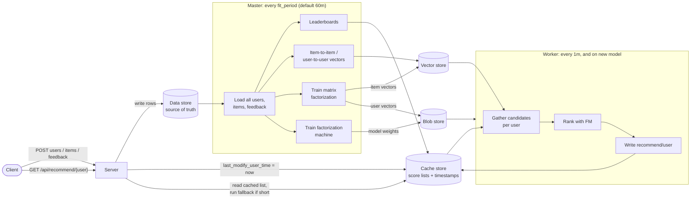
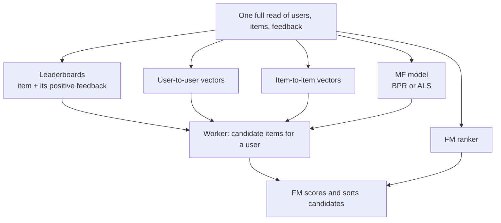
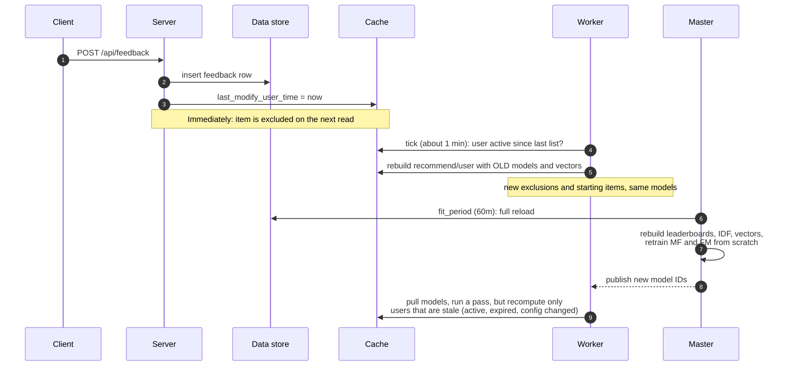

# Gorse scoring: inputs, outputs, score formulas, and update propagation

Context: a walkthrough of how Gorse turns users, items and feedback into ranked recommendations, written from reading the
code on `master` (44791ec). It answers four questions: what goes in, what comes out, how each score is computed, and how
long new input takes to change a score. The online request path and its latency problems are covered separately in
[performance-analysis.md](performance-analysis.md).

The short version: Gorse is batch-first. Nothing is rescored when feedback arrives. The master periodically reloads the
whole dataset and rebuilds leaderboards, similarity vectors and models. Workers then precompute a ranked list for every
user into the cache. The REST server reads that list, filters it, and tops it up with fallback recommenders.

## 1. Architecture at a glance



## 2. Inputs

Three record types carry everything (`storage/data/database.go:77-133`):

| Record       | Fields that matter for scoring                                          |
|--------------|-------------------------------------------------------------------------|
| **User**     | `UserId`, `Labels` (any JSON: tags, numbers, embeddings), `Comment`     |
| **Item**     | `ItemId`, `Categories`, `Timestamp`, `Labels`, `Comment`, `IsHidden`    |
| **Feedback** | key `(FeedbackType, UserId, ItemId)`, plus `Value` and `Timestamp`      |

`FeedbackType` is a free-form string. Config in `[recommend.data_source]` gives it meaning:

- `positive_feedback_types` (e.g. `["star", "like", "read>=3"]`): the user liked the item. The `>=3` form matches on
  `Value` (`common/expression/expression.go:156`).
- `read_feedback_types` (e.g. `["read"]`): the user saw the item. Without positive feedback on the same pair, this counts
  as an **implicit negative**.
- `negative_feedback_types`: explicit dislikes. These win over everything else on the same pair.

The priority (explicit negative > positive > read) is applied while the master loads the dataset
(`master/tasks.go:495-710`).

Any feedback at all also puts the item into the user's **exclude set**, so items the user already touched are never
recommended again. The exception is when `[recommend.replacement]` is enabled (`logics/recommend.go:61-90`).

## 3. Outputs

Every output is a sorted list of `(id, score, categories, timestamp)`:

| Output                                         | Stored in    | Produced by | Read by                                   |
|------------------------------------------------|--------------|-------------|-------------------------------------------|
| `non-personalized/<name>` (leaderboards)       | cache        | master      | `GET /api/non-personalized/{name}`        |
| item-to-item / user-to-user neighbours         | vector store | master      | `GET /api/item-to-item/...`, `/api/user-to-user/...` |
| `collaborative_filtering/<user>`               | cache        | worker      | `GET /api/collaborative-filtering/{user}` |
| **`recommend/<user>`** (final ranked list)     | cache        | worker      | **`GET /api/recommend/{user}`**           |

The main output is `GET /api/recommend/{user}` (`server/rest.go:1001`). It reads `recommend/<user>`, drops excluded
items, and if fewer than `n` remain it appends items from `[recommend.fallback].recommenders`
(`logics/recommend.go:107-131`).

`POST /api/session/recommend` is the stateless variant: the caller sends feedback in the body and gets item-to-item
results computed on the fly, with no stored user.

## 4. How each score is calculated

Scoring runs in two stages. **Candidate generators** produce a broad pool (recall), then one **ranker** orders it
(precision).

### 4.1 Candidate generators

| Recommender               | Score                                                                                                                                              | Where                                                  |
|---------------------------|----------------------------------------------------------------------------------------------------------------------------------------------------|--------------------------------------------------------|
| `latest`                  | `item.Timestamp` as Unix seconds                                                                                                                   | `logics/recommend.go:180`                              |
| `non-personalized/<name>` | A user-written `expr` formula over `item` and that item's **positive** feedback. Default `count(feedback, .FeedbackType == 'star')`, filtered to the last 168h. Top `cache_size` kept overall and per category. | `logics/non_personalized.go`                           |
| `item-to-item/<name>`     | For each of the user's recent positive items `i`, find nearest neighbours `j` and sum: `score(j) = Σ sim(i, j)`                                     | `logics/recommend.go:244`                              |
| `user-to-user/<name>`     | Find the user's nearest-neighbour users `v`, then `score(item) = Σ sim(u, v)` over neighbours who liked the item                                    | `logics/recommend.go:285`                              |
| `collaborative`           | Matrix factorization: `score = p_u · q_i`, found by ANN search over item vectors                                                                    | `worker/pipeline.go:412`, `model/cf/model.go:195`      |
| `external/<name>`         | A JavaScript script returns item IDs; no score                                                                                                     | `logics/external.go`                                   |

Note that the non-personalized formula only ever sees feedback that matches `positive_feedback_types`, because the
master streams only those rows into it (`master/tasks.go:551-620`). A formula counting a non-positive type always
evaluates to 0.

### 4.2 Similarity used by item-to-item and user-to-user

Defined in `logics/item_to_item.go` and `logics/user_to_user.go`:

- **`embedding`**: Euclidean distance `d` between vectors supplied in `Labels` (e.g. `item.Labels.embedding`), turned
  into `sim = 1 / (1 + d)`. The vector store returns `-d` (`storage/vectors/xvec.go:447`) and the query applies
  `1 / (1 - score)` (`logics/item_to_item.go:78`).
- **`tags` / `users` / `items`**: a sparse vector with one entry `√IDF(x)` per tag, user or item, so the dot product is
  `sim = Σ IDF(x)` over what the two share.
  - `IDF(x) = log(1 + N / freq(x))` (`dataset/dataset.go:161-197`). Sharing a rare tag or a niche item counts far more
    than sharing a popular one.
  - Each sparse vector keeps only its top 1024 entries by weight (`logics/vector_writer.go:36`).
- **`auto`**: tags concatenated with users (or items) into one vector, score multiplied by 0.5.

### 4.3 Matrix factorization (the `collaborative` generator)

`model/cf/model.go` trains on positive feedback only. Both algorithms use 16 latent factors and early stopping on
NDCG@10 against a held-out split.

- **BPR** (default): sample `(u, i⁺, j⁻)` where `j⁻` is an item the user never liked, and use SGD to push
  `p_u·q_i⁺ − p_u·q_j⁻` up, minimizing `log(1 + e^−diff)`.
- **eALS**: element-wise alternating least squares for implicit feedback, with weight `alpha` on unobserved pairs.

After training, the master writes item vectors into a new vector collection (dot-product distance) and user vectors into
the blob store, keyed by a fresh model ID (`master/tasks.go:885-1044`).

### 4.4 Ranker: the final per-user score

With `[recommend.ranker] type = "fm"`, the worker pools candidates from `ranker.recommenders`, **discards their original
scores**, and rescores each one with a factorization machine (`model/ctr/fm.go:111`):

```
x = one-hot(user_id) + one-hot(item_id) + user label features + item label features
ŷ = b + Σ wₖxₖ + ½ Σ_f [ (Σₖ v_kf xₖ)² − Σₖ v_kf² xₖ² ]   (+ one term per item-embedding label)
```

- **Training data:** positive feedback is the positive class; explicit negatives and read-only feedback are the
  negative class. The loss is binary cross-entropy with logits (`master/tasks.go:741-770`, `model/ctr/fm.go:360`).
- **Stored score:** the raw logit `ŷ`. Items are sorted by it and written to `recommend/<user>`
  (`worker/pipeline.go:460`).

Other ranker types:

- **`reranker`**: sends candidates to an LLM rerank API.
- **`decision`**: calls a Decision API for a yes/no per candidate.
- **`none`**: candidate lists are **concatenated in config order**, not merged by score. This matters because the
  generators' scores live on unrelated scales (timestamps, IDF sums, dot products) and cannot be compared.

### 4.5 Replacement

With `[recommend.replacement] enable_replacement = true`, items the user already interacted with go back into the pool
before ranking. After ranking their scores are multiplied by `positive_replacement_decay` (0.8, previously liked) or
`read_replacement_decay` (0.6, only read), then the list is re-sorted (`worker/pipeline.go:610-688`).

### 4.6 How the pieces relate, and what each model is trained on

The master's outputs are five **independent** computations that share one data load. None consumes another's output;
they only meet in the worker, where four of them supply candidates and the FM orders them.



The order in `runLoadDatasetTask` (`master/tasks.go:252`) is: load the dataset (leaderboards are computed during this
same pass), then user-to-user, item-to-item, MF, FM. They run sequentially only because they share the loaded data.

The two trained models are **not** trained on the leaderboards or the similarity vectors. Both read the raw data:

| Model | Training input | Learns | Used as |
|---|---|---|---|
| **MF** (BPR or ALS) | Only the (user, item) pairs with positive feedback. `Value`, labels and content are ignored. | A 16-number vector per user and per item, so that `user · item` is high for liked items | The `collaborative` candidate generator |
| **FM** | (user, item) pairs labelled 1 (positive) or 0 (explicit negative, or read but not liked), with features: user ID, item ID, user labels, item labels, item embeddings | Probability that a user likes an item, from IDs plus content | The ranker that orders all candidates |

Two consequences:

- **The FM ignores where a candidate came from.** A candidate's leaderboard rank, similarity or MF score is not a
  feature.
- **MF item vectors are not reused for item-to-item.** They encode item similarity too, but `item-to-item` with type
  `users` exploits the same "who liked what" signal through a separate, IDF-weighted computation.

Item-to-item and user-to-user scores are similarity scores, not statistical correlation. For the `tags`, `users` and
`items` types the score is a raw IDF-weighted count of what two entities share, not normalized by how much each has
(not cosine). Popular items share users with almost everything, so they tend to rank as "similar" to many items.

## 5. How new input propagates into scores

Inserting feedback (`server/rest.go:1929`) does exactly two things: it writes the row to the data store, and it sets
`last_modify_user_time[user]` and `last_modify_item_time[item]` to now in the cache. Nothing is rescored at that moment.



| When                                    | What reflects the new feedback                                                                                                                                                                       |
|-----------------------------------------|------------------------------------------------------------------------------------------------------------------------------------------------------------------------------------------------------|
| **Immediately** (next request)          | The item joins the exclude set and disappears from the user's results. The online fallback `item-to-item` uses the user's latest positive items as starting points, but the neighbour vectors are from the last master cycle. |
| **About 1 min** (worker tick)           | The worker regenerates the user's list because they were active after their last list (`worker/pipeline.go:357`). Same generators and models, but new starting set and exclusions.                    |
| **Each `fit_period`** (default 60m)     | The master reloads everything (full table scan) and rebuilds leaderboards, IDF weights, item and user vectors, the FM model and the MF model. MF and FM retraining are skipped if the feedback count is unchanged (`master/tasks.go:899,1070`). New model IDs are published and workers download them, but the staleness check does not look at model version, so only users who are otherwise stale get a list from the new model (see 5.1). |
| **Each `optimize_period`** (default 6h) | Hyperparameter search (BPR vs ALS, learning rate, regularization). The winner is adopted at the next fit only if its NDCG beats the current model (`master/tasks.go:905-919`).                        |

### 5.1 Consequences worth knowing

- **No incremental or online learning.** Every model is retrained from scratch on the full dataset. A user's
  collaborative-filtering vector does not move until the next retrain.
- **A new model does not refresh inactive users.** The worker's staleness check compares a config digest, timestamps
  and user activity, not model IDs (`worker/pipeline.go:357-410`). A user with no new activity keeps a list built from
  an older model until it ages past `recommend.cache_expire` (72h).
- **New users get no precomputed list until the next retrain.** The worker skips users with no positive feedback, and
  users with no MF vector when MF is enabled (`worker/pipeline.go:186-203`). Until then they are served only by the
  online fallback (default `item-to-item/neighbors`, then `latest`).
- **Users with a single like never get a precomputed list.** To measure MF quality, the master holds out one random
  positive feedback row per user and trains on the rest; the deployed model is the one trained without those rows
  (`dataset/dataset.go:269-284`). A user whose positive feedback is one row has nothing left to train on, gets no MF
  vector (`model/cf/model.go:134-137`), and is skipped by the worker when MF is enabled (`worker/pipeline.go:207`).
  They only get fallback recommendations until they like a second item. Items with a single like lose their MF vector
  the same way when that row is the one held out.
- **New items** surface only through `latest`, embedding-based item-to-item (if their labels carry an embedding), or the
  next master cycle. The FM ranker scores them from label features alone, because their item ID is not yet in the
  trained index.
- **Config changes invalidate every list.** Each list stores a digest of the recommend config; a mismatch forces
  regeneration (`worker/pipeline.go:374-384`).
- **Lists expire** after `recommend.cache_expire` (72h).
- **`ranker.cache_expire` (120h) is effectively unused with the defaults.** The 72h check runs first and already marks
  the list stale (`worker/pipeline.go:397-408`), so the 120h branch for inactive users can only fire if
  `recommend.cache_expire` is set higher than `ranker.cache_expire`.

## 6. System design

- **Master** (`master/`): the only stateful component. `RunTasksLoop` fires on a ticker of
  `min(collaborative.fit_period, ranker.fit_period)` (`master/master.go:140,456`) and runs `runLoadDatasetTask`
  (`master/tasks.go:252`). It owns the meta store (current model IDs) and the blob store (serialized models), and serves
  gRPC so other nodes can pull config and models.
- **Workers** (`worker/`): split users with a consistent hash ring (`worker/worker.go:478`), so adding workers scales
  precomputation horizontally. They poll the master for new model IDs, download from the blob store
  (`worker/worker.go:271`), and run the per-user pipeline (`worker/pipeline.go:124`) every `--interval` (default 1m) or
  when a new model arrives.
- **Servers** (`server/`): stateless REST nodes. Reads hit the cache; writes hit the data store. Scale behind a load
  balancer.
- **Stores**, each a separate URI in config:
  - data store (MySQL / Postgres / Mongo): source of truth
  - cache store (Redis, etc.): all score lists and timestamps
  - vector store (`xvec`, Qdrant, Milvus, Weaviate): MF item vectors and similarity vectors, queried by ANN search
  - blob store (local dir, S3, GCS, Azure): MF user vectors and FM weights
- **`gorse-in-one`**: the master in standalone mode, which also serves the REST API and runs the worker pipeline inline
  (`master/tasks.go:1376`).

The trade-off: the expensive math (training, index builds, per-user ranking) runs offline on a timer, so the request
path is mostly cache reads and filtering. The cost is freshness, since new behaviour takes minutes to hours to reach the
scores.

## 7. Efficiency: what is recomputed, and what could be incremental

Nothing in Gorse is incremental at the data level. The master recomputes everything on every cycle. The worker narrows
its work to stale users, but it still scans every user every minute, and it rebuilds each stale user's list from scratch.

### 7.1 Master: full recompute every `fit_period`

Each cycle does all of the following, however much or little changed:

- **Full reload.** Every user, item and feedback row is streamed from the data store into memory
  (`master/tasks.go:78`). There is no "changed since" filter, even though `Item.UpdateAt`, `User.UpdateAt` and
  `Feedback.Updated` exist.
- **Leaderboards** are recomputed for every item.
- **Item-to-item and user-to-user vectors** are rebuilt and rewritten for every item and user, with no change detection
  (`master/tasks.go:787-884`). Vectors from the previous cycle are then deleted by timestamp.
- **MF and FM are retrained from random weights.** MF item vectors go into a brand-new vector collection each time.
  Nothing starts from the previous weights.
- **The only skip is crude:** retraining is skipped when the total feedback count equals last cycle's
  (`master/tasks.go:899,1070`). One delete plus one insert in the same hour counts as "unchanged".
- **Hyperparameter search** adds more full trainings every `optimize_period`.

### 7.2 Worker: per-user, but with a full scan every minute

Every `--interval` (default 1m), and whenever a new model is pulled, the worker:

1. Streams **all** users from the data store and keeps the ones the hash ring assigns to it (`worker/worker.go:472`).
2. Runs a staleness check on each one, costing about four cache reads per user. One of them loads the user's whole
   cached list (`worker/pipeline.go:357`).
3. Recomputes only users that are stale: active since their last list, list older than `recommend.cache_expire`,
   config digest changed, or no list yet.

So the polling cost grows with the total number of users even when nothing happened.

Each recomputed user is also rebuilt from scratch:

- The user's full feedback history is loaded.
- Every candidate generator is re-run.
- Offline item-to-item issues one ANN query per item the user **ever** liked. `context_size` caps this only for
  online requests (`logics/recommend.go:253`).

The model-version gap from 5.1 is the opposite problem: inactive users are *not* recomputed when a better model
arrives, so they keep lists from an older model for up to 72h.

### 7.3 Inherent vs. avoidable recomputation

Some global recomputation is inherent to the algorithms:

- **IDF weights** depend on global counts, so any new feedback slightly shifts every sparse similarity score.
- **MF item vectors** move whenever the data changes. Neither BPR nor eALS supports an exact incremental update.

The rest is avoidable:

| Waste                                                   | Incremental alternative                                                                                                                         |
|---------------------------------------------------------|-------------------------------------------------------------------------------------------------------------------------------------------------|
| Full table scan every cycle                             | Read only rows changed since the last cycle via the `UpdateAt` / `Updated` columns (needs an index on them), and keep the dataset in memory between cycles |
| Rewriting every item/user similarity vector             | Rewrite only items/users whose feedback or labels changed; accept small IDF drift and do a full rebuild on a slower schedule                       |
| Retraining from random weights                          | Warm-start from the previous model's weights; training should then converge in a few epochs instead of up to 100                                |
| New or active users wait up to `fit_period` for an MF vector | **Fold-in:** solve just that user's vector against the fixed item vectors (one small linear solve with ALS), so new users get personalized results within one worker tick |
| Count-based leaderboards rebuilt by scanning            | Increment a Redis sorted set (`ZINCRBY`) on each feedback write; keep the batch rebuild only for formulas that can't be updated incrementally |
| Worker scans all users every minute                     | A "dirty users" queue filled by the write path, so each pass touches only users with new activity                                              |
| New model doesn't refresh inactive users                | Include the model IDs in the staleness digest so each new model triggers a refresh, spread over time to avoid a thundering herd                 |
| Offline item-to-item queries every liked item           | Apply `context_size` offline as well, or cache per-item neighbour lists so users who share items share the lookups                              |

### 7.4 Measure before changing

At about 50k users and 200k videos, a master cycle is probably still minutes, not hours. The more visible problems are
likely the freshness gaps (new users waiting for a retrain, inactive users on old models), not CPU cost. These
Prometheus gauges show where the time actually goes:

| Metric                                                       | What it shows                                     |
|--------------------------------------------------------------|---------------------------------------------------|
| `gorse_master_load_dataset_total_seconds`                    | Full reload time per cycle                        |
| `gorse_master_load_dataset_step_seconds{step=...}`           | Reload broken down by step                        |
| `gorse_master_collaborative_filtering_fit_seconds`            | MF training time                                  |
| `gorse_worker_offline_recommend_total_seconds`               | Duration of one worker pass                       |
| `gorse_worker_update_user_recommend_total`                   | Users actually recomputed in that pass            |

`gorse_worker_offline_recommend_step_seconds` always reads 0. Its per-step timers are declared in
`worker/pipeline.go:164-171` but never incremented. There is no gauge for FM training time; use the master's
`fit AFM` log lines instead.

## 8. Embedding-based item-to-item at scale: storage and compute

### 8.1 Video costs no more than any other embedding

Gorse never sees the video. It receives one fixed-length vector per item in `item.Labels.embedding` and treats it the
same whether it came from text, an image or a video. Storage and compute depend only on **number of items × vector
dimension**.

Common image and video embedding models output 512–1,408 dimensions (CLIP ViT-B/32 gives 512, ViT-L/14 gives 768),
the same range as text models such as `mxbai-embed-large` (1,024) in the default config. The video-specific heavy work
is generating the embedding (running a model over frames or clips). That happens once per video, outside Gorse.

### 8.2 How Gorse stores and indexes these vectors

- Dense embeddings are stored as **FP16** in an **HNSW** index with M=50, efConstruction=500, efSearch=300 (xvec
  defaults, `storage/vectors/xvec.go:267-270`).
- Sparse vectors (`tags`, `users`, `items`, `auto` types) use a **flat**, brute-force index instead
  (`storage/vectors/xvec.go:267`).
- Index build and query parallelism are both set from `master.n_jobs` (`storage/vectors/xvec.go:95-96`,
  `master/master.go:320`), which defaults to **1**.
- Every cycle the master upserts every item vector, changed or not, then optimizes the collection. Because every
  vector is rewritten, this is effectively a full index rebuild each `fit_period`.

### 8.3 Published benchmark: xvec, 100k × 768 dimensions

From the xvec module's `docs/benchmark-hnsw.csv` (pinned version `v0.0.0-20261002134013-db70c9ad03b0`), run on a GCP
e2-standard-8 (8 vCPU, 32 GB) with exactly Gorse's settings above, FP16, top-100 results:

| Metric                                   | Value                                         |
|------------------------------------------|-----------------------------------------------|
| Insert 100k vectors                      | 5.1 s                                         |
| Build the index (8 threads)              | 76.6 s                                        |
| Query latency, one at a time             | 7.4 ms average, 10.8 ms p99                   |
| Throughput                               | 128 queries/s serial; 876 queries/s concurrent |
| Recall@100                               | 99.7%                                         |
| Peak memory (RSS)                        | 1.8 GB                                        |

Other quantization levels from the same file: int8 reached 99.0% recall at 290 queries/s serial; int4 dropped to
88.0% recall. Peak memory did not fall meaningfully with quantization in xvec.

### 8.4 Estimate for 200k videos

These figures are **extrapolated** from the benchmark, not measured. Index build is scaled as roughly `N log N`, and
the single-thread figure assumes build time scales about linearly with threads.

|                                                          | 768 dims  | 1,024 dims |
|----------------------------------------------------------|-----------|------------|
| Raw vectors in FP16 (items × dims × 2 bytes)             | 307 MB    | 410 MB     |
| Peak memory during index build                           | ~3.5 GB   | ~4.5 GB    |
| Index build, 8 threads                                   | ~3 min    | ~4 min     |
| **Index build, default `master.n_jobs = 1`**             | **~20 min** | **~25 min** |
| One similarity query                                     | ~7–8 ms   | ~9–10 ms   |
| Embeddings as JSON text in the data store                | ~1.5–2 GB | ~2–2.5 GB  |

For comparison, the MF item vectors are 16 dimensions: 200k × 16 × 2 bytes ≈ 6 MB.

### 8.5 Where the cost actually is

Storage is not the problem: a few hundred MB of vectors and a few GB of peak memory fit on one machine. The cost
comes from recomputing everything every cycle:

1. **Index rebuild every `fit_period`.** At `n_jobs = 1`, the rebuild alone could take about 20 of every 60 minutes.
2. **All embeddings re-read and re-parsed as JSON.** Each cycle the master loads every item's labels, about 9 KB of
   embedding text per video at 768 dimensions (`master/tasks.go:404-440`). The FM ranker also trains on these
   embeddings as features.
3. **Queries pile up per user.** Each query is about 7 ms, but the worker runs one per item the user ever liked (no
   cap), and the online fallback runs up to `context_size` (100) per request, sequentially. A user with 100 likes costs
   about 0.75 s of query time; see B1 in [performance-analysis.md](performance-analysis.md).

The sparse types are a separate case: their flat index scans every vector per query, and the published benchmarks do
not cover sparse vectors.

### 8.6 Cheap mitigations

- **Raise `master.n_jobs`** to the number of cores. Index build time should drop roughly in proportion.
- **Use smaller vectors**: a lower-dimension model, or truncation if the model supports it (Matryoshka-style models).
- **int8 quantization** (`[database.vector] quantization_type = "sq"`, `quantization_bits = 8`): 99.0% recall and
  faster serial queries in the benchmark, but no meaningful memory saving in xvec.
- **Lengthen `fit_period`** if hourly freshness is not needed.
- **External vector database** (Qdrant, Milvus): moves the build off the master, though Gorse still rewrites every
  vector each cycle.

To replace the 8.4 extrapolations with measurements, run Gorse's own xvec adapter locally at 200k vectors and the
target dimension, comparing `n_jobs = 1` against all cores.
