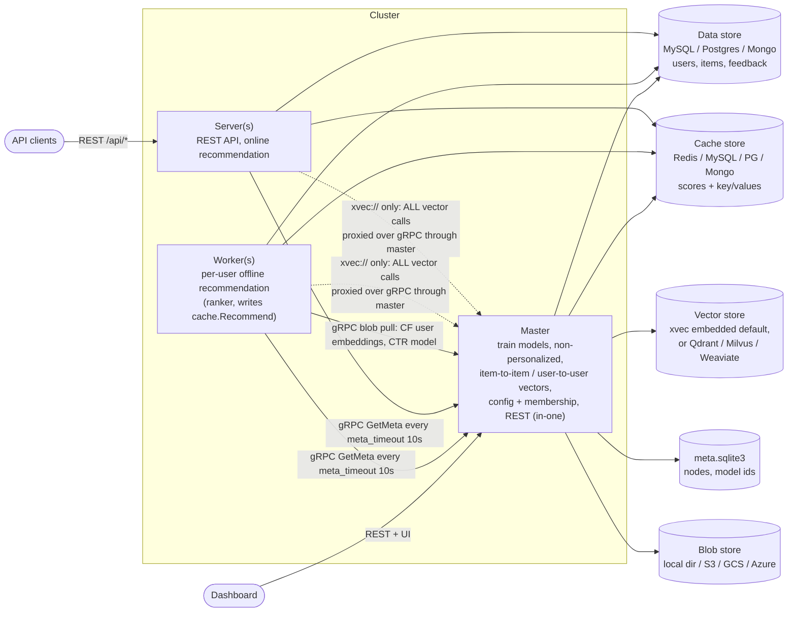
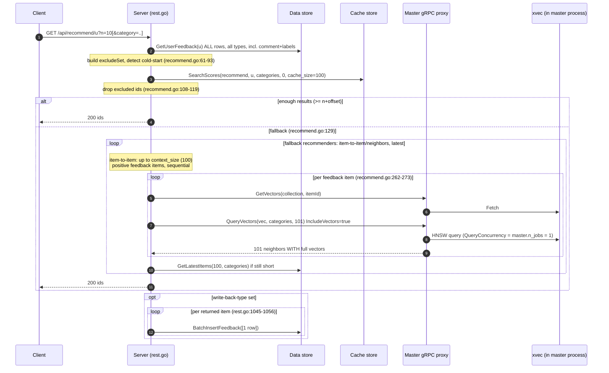
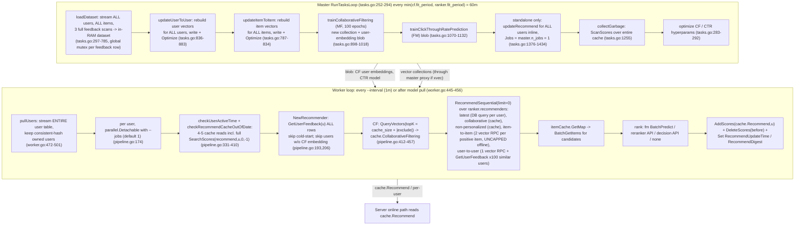

# Gorse backend: structure, request path, and scalability analysis

Context: a deployment with ~50k users and ~200k videos reports `GET /api/recommend/{user}` taking more than 3 s.
This document maps the backend, traces the request path, and ranks the bottlenecks found by reading the code.
Nothing here was measured; every claim points at the code that supports it. The "How to confirm" section at the end
describes how to turn the top hypothesis into evidence.

## 1. Component architecture

Key facts behind the diagram:

- The master always opens the stores directly (`master/master.go:296-323`). It also registers gRPC proxy servers for the
  cache, data and vector stores (`master/master.go:396-398`).
- Servers and workers connect to SQL/Redis/Mongo stores directly, but when `vector_store = "xvec://..."` (the default) they
  cannot open the embedded store, so they route every vector call through the master proxy
  (`server/server.go:239-241`, `worker/worker.go:216-218`). The same applies to the data/cache stores when they are SQLite.
- `gorse-in-one` is just the master in standalone mode: it serves the REST API itself (`Master` embeds `server.RestServer`,
  `master/master.go:74`) and runs the worker pipeline inline inside its own task loop (`master/tasks.go:1376-1434`).

## 2. Online request path: `GET /api/recommend/{user-id}`

What decides whether a request takes the fast path (two store calls) or the slow fallback path:

| Condition | Result | Evidence |
|---|---|---|
| `recommend.ranker.type = "none"` | Every request runs the full online recommender chain | `logics/recommend.go:108,121` |
| User has no `cache.Recommend` entry | Fallback on every request | see worker section: cold-start, no CF embedding, inactive users are skipped |
| Cached list shorter than `n + offset` after exclusions | Fallback | `logics/recommend.go:129` |
| Category filter leaves < n cached items | Fallback | `cache.Recommend` is filtered by categories at read time |

## 3. Offline pipeline (master + worker)

## 4. Storage layouts that matter for scale

**Cache store (scores).** Every per-user list (`recommend`, `collaborative-filtering`) and every non-personalized list is a set
of rows/hashes `(collection, subset, id, score, categories, is_hidden, timestamp)`.

- Redis: one RediSearch index over all documents (`storage/cache/redis.go:110-122`); reads are `FT.SEARCH ... SORTBY score`
  with TAG filters (`redis.go:256-274`); writes are one `HSET` per item in a pipeline (`redis.go:316-330`).
  At 50k users x `cache_size` 100 x 2 collections this is ~10M hashes resident in Redis.
- MySQL/Postgres: `SELECT ... WHERE collection=? AND subset=? AND is_hidden=false [AND JSON_CONTAINS(categories,?)]
  ORDER BY score DESC LIMIT` (`storage/cache/sql.go:350-402`). MySQL gets a multi-valued index on
  `(collection, subset, categories)`; **MariaDB gets no categories index at all** (`sql.go:201-215`), so filtered reads
  scan the subset's rows. Fine at 100 rows per subset, bad if `cache_size` is raised.

**Data store.** `feedback` has indexes on `user_id` and `item_id` (`storage/data/sql.go:240-241`). `GetUserFeedback`
has no row limit and selects `labels` and `comment` for every row (`sql.go:1158-1162`). `GetLatestItems` with categories
uses `JSON_CONTAINS`, which cannot use an index, so it walks `time_stamp_index` until it finds `n` matches
(`sql.go:903-934`).

**Vector store (xvec default).** Dense collections (embedding item-to-item, CF item factors) get HNSW; sparse collections
(`tags`, `items`, `users`, `auto` types) get a **Flat index, i.e. brute force** (`storage/vectors/xvec.go:263-269`,
query params at `:426-431`). The process-wide query concurrency is set from `master.n_jobs`
(`xvec.go:93-99`, called with `WithNumJobs(m.Config.Master.NumJobs)` at `master/master.go:319-320`), and
`n_jobs` defaults to 1 (`config/config.go:567`). Every query returns full vectors (`IncludeVectors: true`, `xvec.go:423`)
and performs an extra `DescribeCollection` (`xvec.go:437`).

## 5. Bottlenecks, ranked by likely contribution to the 3 s

### B1. Online fallback does up to 200 sequential gRPC round trips through a single-slot vector store (most likely cause)

Path: `rest.go:1027-1032` -> `recommend.go:129` -> `recommend.go:250-273` -> `logics/item_to_item.go` (`GetVectors` +
`QueryVectors` per feedback item) -> `vectors.ProxyClient` -> master gRPC -> xvec.

- The online item-to-item loop is bounded only by `context_size`, default **100**, and runs **sequentially**. With the
  default config every call is two gRPC hops to the master (`server/server.go:239-241`).
- On the master every `QueryVectors` waits for the xvec runtime limiter, sized to `master.n_jobs` = **1**. All servers,
  all workers and the master's own tasks share that one slot. While the worker is mid-pass (which also does two vector
  RPCs per positive item per user, uncapped), online requests queue behind it.
- Each `QueryVectors` response carries 101 neighbor vectors (1024-d by default config) that the server immediately throws
  away, so ~100 x ~200-400 KB of protobuf per request.
- `Xvec.QueryVectors` always filters on `hidden = false`, even without categories (`xvec.go:408`), which roughly
  doubles the HNSW search cost. Reference numbers and an estimation model are in
  [recommend-latency-estimation.md](recommend-latency-estimation.md).
- The same pattern is in `POST /api/session/recommend` (`rest.go:1128-1150`).

Who hits this path: every user with no `cache.Recommend` entry (next item) and any request whose cached list is shorter
than `n + offset` after excluding seen items or filtering by category.

### B2. Many users never get an offline recommendation, so they always fall back

- The worker skips cold-start users and **users without a CF embedding** (`worker/pipeline.go:193, 206-208`). A user who
  signs up or first interacts after the last CF fit has no embedding until the next `fit_period` (60 min) **and** the next
  worker pass. Until then every one of their requests goes through B1. B1's cost scales with the user's liked items,
  so cold-start users (none) are cheap and users who liked a few items since the last fit are moderate; the expensive
  case is established users whose saved list runs short, e.g. under a category filter.
- Users inactive longer than `active_user_ttl` have their cache **deleted** (`pipeline.go:331-354`). Off by default
  (`active_user_ttl = 0`).
- Worker throughput is low by default: `--jobs 1` (`cmd/gorse-worker/main.go:90`), 4-5 cache round trips per user per
  tick just to decide to skip (`pipeline.go:357-410`, including a `SearchScores(..., 0, -1)` that fetches the whole list
  to check emptiness), a full user-table scan every minute (`worker.go:485`), and per user: an uncapped item-to-item N x 2
  vector RPCs, user-to-user N+1 `GetUserFeedback` for up to 100 similar users (`recommend.go:298-310`), and a
  `GetLatestItems` DB query whose result is identical for every user (`recommend.go:185`). At 50k users this pass can
  take hours with one job, so a large share of users are stale or missing at any given moment.

### B3. Every request loads the user's full feedback history

`recommend.go:63` calls `GetUserFeedback(userId, now)` with no type filter, no time window and no limit, selecting
`comment` and `labels` for every row (`storage/data/sql.go:1158`). For a video service where every play is a `read`
feedback, heavy users have thousands of rows per request, each deserialized by GORM; `SortFeedbacks` then sorts them
(`recommend.go:252`). `positive_feedback_ttl` is not applied on this path. This is pure per-request overhead whether or not
the cache is warm.

### B4. Standalone (`gorse-in-one`) serves API and trains in the same process with `n_jobs = 1`

The master loop reloads the entire dataset into RAM every cycle (`tasks.go:297-785`), rebuilds all item and user vectors,
retrains MF for 100 epochs whenever the feedback count changed, and then runs the full per-user recommendation pass inline
with one job (`tasks.go:1383`). REST requests are served from the same process (`master/master.go:74`) and share the
one-slot xvec limiter. GC and CPU pressure from training land directly on request latency.

### B5. Write-back inserts one row per returned item

`rest.go:1045-1056` calls `BatchInsertFeedback` once per item, so `write-back-type` turns a 10-item response into 10 extra
DB round trips, each of which also bumps `LastModifyUserTime`.

### B6. Scale limits that will bite next (not the current 3 s)

- Cache store size: ~10M score rows/hashes at 50k users; Redis memory and `collectGarbage` full scans
  (`tasks.go:1255-1274`) grow linearly.
- Sparse vector types (`tags`, `items`, `users`, `auto`) are brute-force in xvec. A `user-to-user` of type `items` scans
  50k sparse vectors per query; an item-to-item of type `tags` scans 200k.
- Item and user vector collections are fully rewritten and re-optimized every cycle (`tasks.go:787-883`).
- MariaDB as cache store has no categories index (`storage/cache/sql.go:201-215`).
- `GetLatestItems` with categories cannot use an index on MySQL/Postgres because of `JSON_CONTAINS` / `@>` on `json`.

## 6. Suggested changes

### Config-only, can be applied today

1. **Raise `master.n_jobs`** to the master's core count. This lifts the xvec query limiter from 1 to N, parallelizes
   dataset loading, and (standalone) parallelizes the recommendation pass. Expect the biggest single improvement under
   load with no code change.
2. **Run workers with `--jobs` >= 8** so the offline pass finishes well inside `cache_expire`, and fewer users hit
   fallback.
3. **Lower `recommend.context_size`** (e.g. 10-20). It caps the online item-to-item loop, so a cold fallback goes from
   up to 200 vector RPCs to 20-40.
4. **Make the fallback cheap**: set `recommend.fallback.recommenders` to `["non-personalized/<x>", "latest"]` and keep
   item-to-item offline only. The fallback then becomes one cache read and one DB read.
5. **Use an external vector store** (Qdrant/Milvus/Weaviate) instead of `xvec://`. Servers and workers then query the
   vector store directly instead of through the master's gRPC proxy, and the master's `n_jobs` no longer throttles them.
6. Set `recommend.data_source.positive_feedback_ttl` and `read_feedback_types` deliberately so the offline dataset
   and feedback history stop growing without bound.

### Code changes, in priority order

1. **Decouple xvec query concurrency from `master.n_jobs`** (`storage/vectors/xvec.go:93-99`). Default the runtime
   `QueryConcurrency` to `GOMAXPROCS` and keep `n_jobs` for training only. One-line change with cluster-wide effect.
2. **Batch and parallelize online item-to-item** (`logics/recommend.go:250-273`, `logics/item_to_item.go`): one
   `GetVectors(ids...)` for all context items, then `QueryVectors` concurrently with an `errgroup` bounded to ~8, or add a
   batch-query RPC. Stop requesting `IncludeVectors` for neighbor searches and cache `DescribeCollection` per collection
   (`xvec.go:423, 437`). Apply the same to `sessionRecommend`.
3. **Trim the per-request feedback load** (`recommend.go:63`, `storage/data/sql.go:1158`): add a `GetUserFeedback`
   variant that selects only `feedback_type, item_id, value, time_stamp`, honours `positive_feedback_ttl`, and caps rows
   (newest first). Even better, precompute the exclude set offline and store it as one cache value per user.
4. **Produce offline recommendations for every user**, including cold-start and no-embedding users (e.g. from
   non-personalized + latest), so the server never needs the online fallback for a known user
   (`worker/pipeline.go:193, 206-208`).
5. **Worker incremental refresh**: query users by `update_at > lastPass` instead of streaming the whole table every
   minute (`worker.go:472-501`); replace the full-list `SearchScores(..., 0, -1)` staleness probe with a count or the
   `RecommendUpdateTime` key alone (`pipeline.go:365`); compute `latest` once per pass (`recommend.go:185`); add a
   `BatchGetUserFeedback(userIds)` for user-to-user (`recommend.go:298-310`); cap the offline item-to-item context too.
6. **Batch write-back** into a single `BatchInsertFeedback` call (`rest.go:1045-1056`).
7. **Add a short in-process TTL cache on the server** for non-personalized lists, `latest`, and the `*Digest` keys so
   repeated requests do not re-hit the cache store for identical results.
8. **Stop skipping unindexed segments silently** or at least surface it: with `SkipUnindexedSegments(true)` on the master
   (`master/master.go:320`), items added since the last `Optimize` are invisible to online item-to-item queries.

## 7. How to confirm the top hypothesis before changing code

1. Turn on tracing: `[tracing] enable_tracing = true`, `exporter = "otlp"`, point it at a local Jaeger/Tempo. The REST
   layer (`otelrestful`), GORM (`otelsql`), Redis (`redisotel`) and Mongo (`otelmongo`) are already instrumented, so one
   slow request shows the split between `GetUserFeedback`, `SearchScores` and the fallback RPCs.
2. Compare a user that has a `cache.Recommend` entry with one that does not (e.g. a user created after the last CF
   fit). If only the second is slow, B1/B2 are confirmed.
3. Check the `rest_api_request_seconds` histogram (`server/metrics.go:23`) against worker log lines
   (`"complete recommendation"` with `update_user_count`) to see how far behind the offline pass is.
4. Count `GetUserFeedback` rows for the slowest users; if they are in the thousands, B3 is material.

## 8. Related upstream reports (gorse-io/gorse, checked 2026-10-30)

| Report | Matches finding | Status |
|---|---|---|
| [#1414 Loading all user feedback on every recommendation request](https://github.com/gorse-io/gorse/issues/1414) (2026-10-25) | B3 exactly | Open, no maintainer reply |
| [#1175 0.5.x Extremely slow server performance](https://github.com/gorse-io/gorse/issues/1175) (2026-02) | B1, B2, B4: 15 s `GET /recommend` while master trains, 3 ms when master stopped; 500 ms+ scaling with per-user feedback count after disabling the ranker | Open |
| [Discussion #1013](https://github.com/gorse-io/gorse/discussions/1013) (2025-06) | B3 on the worker side (full feedback load for exclusion) | No answer |
| [#949 Cache size keeps growing](https://github.com/gorse-io/gorse/issues/949), [#853 Redis memory](https://github.com/gorse-io/gorse/issues/853), [Discussion #607](https://github.com/gorse-io/gorse/discussions/607) | B6: cache store growth, multiplied by categories; a commenter reports TP99 of 5-30 s on recommend while cache is incomplete | Open |
| [#1217 Worker memory keeps growing](https://github.com/gorse-io/gorse/issues/1217) (2026-03) | B2: unbounded worker item cache; maintainer confirms no eviction, advises restarting workers | Open |
| [#854 Slow "Find neighbors of users"](https://github.com/gorse-io/gorse/issues/854), [#509 Slow tasks](https://github.com/gorse-io/gorse/issues/509) | Master full-rebuild tasks at scale; #509 closed by cutting labels 95% | Open / Closed |
| [#1202 HNSW deadlock when n_jobs > 1](https://github.com/gorse-io/gorse/issues/1202) (2026-03, closed) | Raising `n_jobs` used to deadlock; fixed before the xvec HNSW rewrite (#1388) | Closed |

Nothing upstream names the single-slot xvec query limiter tied to `master.n_jobs` (B1) or the master gRPC proxy hop
for `xvec://`. Recent upstream perf work (Sept-Oct 2026) targets the offline side: HNSW for xvec (#1388), FP16 vectors
(#1382/#1383), dataset loading memory (#1394/#1396), Redis `ScanScores` pipelining (#1387), and preparing xvec indexes
before queries (#1391). None of it changes the online request path.
