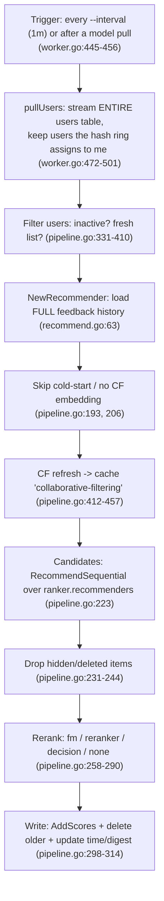

# Worker offline recommendation: flow, cost, and bottlenecks

How a worker builds the cached `recommend` list for each user: user assignment, filtering, candidate generation,
reranking, and write-back. Followed by what can be observed about pass duration and cache size, and the bottlenecks in
the user-filtering step.

Nothing here was measured. Every claim points at the code that supports it; numbers come from published sources and are
marked as such.

## 1. Flow at a glance

## 2. Assigning users to a worker

- The master lists a node only if it called `GetMeta` within `master.meta_timeout` (10s) (`storage/meta/sqlite.go:82-106`).
  Each worker calls `GetMeta` every 10s and receives all worker UUIDs plus its own (`master/rpc.go:57-77`,
  `worker/worker.go:256-257`).
- Each pass, `pullUsers` streams the whole users table in 10k batches and keeps users whose ID maps to itself on a
  consistent-hash ring (`worker/worker.go:472-501`). There is no coordination: every worker scans every user.
- Membership can flicker. The heartbeat period and the TTL are both 10s, and the next heartbeat arrives 10s plus RPC time
  later, so a worker can briefly drop out of the list. If two workers see different peer lists, a user can be computed by
  both or by neither in that pass. This comes from reading the code and has not been observed.
- Inside a worker, users run through `parallel.Detachable` with `--jobs` slots, default 1 (`worker/pipeline.go:174-175`).

## 3. Filtering

### 3.1 Which users are recomputed

Checked in this order; a user is skipped if any check fails:

1. **Inactive.** Only when `active_user_ttl > 0` (default 0, off). Also deletes their list (`pipeline.go:331-354`).
2. **List still fresh** (`pipeline.go:357-410`). Recompute if the list is empty, the digest differs from
   `recommend.Hash()`, the list is older than `recommend.cache_expire` (72h), or the user was active after the list was
   built. With defaults, `ranker.cache_expire` (120h) never decides anything because the 72h check fires first.
3. **Cold-start:** no positive feedback (`pipeline.go:193`). Requires the full feedback load in `NewRecommender`
   (`logics/recommend.go:61-93`).
4. **No collaborative-filtering embedding** while collaborative filtering is enabled (`pipeline.go:206-209`). New users
   wait for the next MF training.

### 3.2 Which items are excluded

- Every item the user ever interacted with. Offline, replacement is ignored when building this set
  (`logics/recommend.go:73`).
- Items already returned by an earlier recommender in the same run, so recommenders don't repeat each other
  (`recommend.go:147`).
- Hidden or deleted items, dropped when candidates are loaded through the item cache (`pipeline.go:231-244`, `698-723`).

## 4. Finding related items

**Step A, collaborative-filtering refresh** (`pipeline.go:412-457`): query the CF collection with the user's embedding for
`cache_size + |excluded|` results, drop excluded items, and write the rest to `collaborative-filtering`.

**Step B:** `RecommendSequential(limit=0)` runs every recommender in `ranker.recommenders` (default `["latest"]`), or
every configured one if the list is empty (`pipeline.go:218-223`):

| Recommender | Work per user | Output |
|---|---|---|
| `latest` | One `GetLatestItems(cache_size)` DB query | ≤ cache_size |
| `collaborative` | Reads the list written in step A | ≤ cache_size |
| `non-personalized/*` | Reads a leaderboard from the cache | ≤ cache_size |
| `item-to-item/*` | `GetVectors` + `QueryVectors` for **every** positive item the user has; scores summed. `context_size` caps this only online (`recommend.go:255`) | ≤ cache_size |
| `user-to-user/*` | One ANN query for up to cache_size neighbours, then `GetUserFeedback` per neighbour | ≤ cache_size |
| `external/*` | HTTP pull | unbounded |

The run's digest is the MD5 of the recommender digests (sorted, so order doesn't matter) and is stored for the staleness
check.

## 5. Reranking and write-back

1. **Replacement** (if enabled and `ranker.type ≠ none`): add previously read or liked items back as candidates
   (`pipeline.go:610-652`).
2. **Rank** by `ranker.type`:
   - `fm`: the CTR model pulled from the master scores every candidate with `BatchPredict`, then sorts
     (`pipeline.go:460-508`).
   - `reranker` / `decision`: external API, given up to `context_size` recent positive items as context. The worker slot
     is detached while waiting (`pipeline.go:536-606`).
   - `none`: candidates kept in generation order.
3. **Replacement decay:** liked items × 0.8, read items × 0.6, then re-sort (`pipeline.go:654-680`).
4. **Write:** one Redis hash per item, delete entries older than this run, set `RecommendUpdateTime` and
   `RecommendDigest` (`pipeline.go:298-314`).

Two side effects:

- **The list is never truncated to `cache_size`.** It can hold up to recommenders × cache_size, plus replacement and
  external items. The online path reads only the top `cache_size` (`logics/recommend.go:109`).
- **With `ranker.type = none` (the default), the online path never reads this list.** It runs the recommenders live
  (`recommend.go:108-123`), but the worker still computes and writes the list. Its only reader is the handler at
  `server/rest.go:988-999`, named `getCollaborativeFiltering` but serving `cache.Recommend`.

## 6. Time to finish all users

No published figure exists for how long a worker pass takes at a known user count. Checked: the v0.4 benchmark page
(per-request timings only) and upstream issues #1175, #1217, #1414, #1419.

What a deployment already exposes:

| Source | Shows |
|---|---|
| `gorse_worker_offline_recommend_total_seconds` | Duration of the last pass on that worker, skipped users included |
| `gorse_worker_update_user_recommend_total` | Users actually recomputed in that pass |
| Log `ranking recommendation` (`n_complete_users`, `throughput` per 10s) | Live progress |
| Dashboard task "Generate recommendation" | May never show complete on small passes (#1419) |
| `gorse_worker_offline_recommend_step_seconds` | Always 0: the timers are declared but never incremented (`pipeline.go:164-171`, `323-327`) |

- Workers run their shards in parallel, so one full cycle takes the slowest worker's `total_seconds`.
- `total_seconds / update_user_recommend_total` approximates cost per recomputed user. It overstates it, because the
  time also covers the user scan and skipped users.

## 7. Cache storage size

**Layout (Redis).** Each (collection, user, item) is its own hash `<prefix>:<collection>:<user>:<item>` with 7 fields,
all in one RediSearch index (`storage/cache/redis.go:110-122`, `236-254`). Each user also has 2 small string keys per
collection (update time and digest).

**Entries per user:**

- `collaborative-filtering`: between `cache_size` and `cache_size + |items the user interacted with|`, because the query
  asks for `cache_size + |excluded|` and only drops excluded hits. A user with 2,000 interactions can hold about 2,100
  entries, of which 100 are ever read.
- `recommend`: up to recommenders × `cache_size` plus replacement items.
- Deleted users: the master garbage-collects their `collaborative-filtering` lists but not their `recommend` lists
  (`master/tasks.go:1252-1276`).
- Inactive users keep their lists forever unless `active_user_ttl > 0`.

**Published sizes.** None for the current layout, which dates from 2023-04. Older reports, not directly comparable:

| Report | Version | Setup | Size |
|---|---|---|---|
| [#853](https://github.com/gorse-io/gorse/issues/853) | not stated | tens of thousands of users | Redis > 50 GB |
| [#892](https://github.com/gorse-io/gorse/issues/892) | v0.5, item neighbours still in Redis | 50k items, 0 users | 16 GB Redis not enough |
| [#949](https://github.com/gorse-io/gorse/issues/949) | v0.4.6, `sorted_sets` table | 10k items, 100k users | Postgres cache 5 TB, 200M rows |

**Measuring a deployment** (read-only):

- `FT.INFO <document index>`: document count and index size.
- `FT.SEARCH <document index> "@collection:{recommend}" LIMIT 0 0`: entry count for one collection.
- `MEMORY USAGE <one entry key>` × entry count: rough hash memory.

## 8. Is the user filtering efficient?

No, not at scale. The filtering logic is correct, but it works by polling. Every pass re-checks every user with
sequential cache calls, and users who can never pass the filter repeat the expensive step every time.

### 8.1 Fixed cost of one pass, even when nothing changed

| Step | Cost | Where |
|---|---|---|
| Stream the whole users table, including `labels` and `comment`, then drop other workers' users | total users × number of workers | `worker/worker.go:472-501`, `storage/data/sql.go:1129` |
| Per owned user: up to 5 cache calls, sequential, unbatched | 4–5 round trips per user | `worker/pipeline.go:331-410` |
| Users processed serially | `--jobs` defaults to 1 | `pipeline.go:174` |

At 50k users that is about 200k–250k sequential Redis calls per pass before any recomputation. The v0.4 benchmark puts
one 100-item cache read at about 0.5 ms. Assuming roughly that per call (an assumption, not a measurement), the checks
alone take about 100 s, longer than the 1-minute interval. The tick loop drops stale ticks (`worker.go:450`), so the
worker ends up scanning continuously and keeps Redis and the database busy even when no one is active.

### 8.2 Bottlenecks, ranked

**B1. Users who can never pass the filter redo the most expensive step every pass.** The staleness check runs before the
cold-start check, and an empty list always counts as stale (`pipeline.go:369`). Each of these users pays a full
`GetUserFeedback` load every minute (no row limit, includes `labels` and `comment`, `storage/data/sql.go:1161`), only to
be skipped:

- Cold-start users (no positive feedback, `pipeline.go:193`). They never get a list, so this repeats forever. A user with
  thousands of read events but no likes is the worst case.
- Users without a CF embedding (`pipeline.go:206`), until the next MF fit, or forever for users the model never covers.
- Users whose recommenders return nothing after filtering. With the default `["latest"]`, a user who has interacted with
  all 100 latest items gets an empty list, so it counts as stale and is fully rebuilt every pass.

**B2. The emptiness check downloads the whole list.** `SearchScores(recommend, user, 0, -1)` runs a sorted RediSearch
query capped at 10,000 entries and returns all 7 fields of each (`pipeline.go:365`, `storage/cache/redis.go:269-271`).
Only `len > 0` is used. Since lists aren't truncated to `cache_size` (section 5), this read grows for heavy users.

**B3. The expensive load runs before the cheap checks.** The full feedback history is loaded (`logics/recommend.go:63`)
before the cold-start and embedding checks. The embedding check is an in-memory lookup and could go first.

**B4. Duplicate and unbatched reads.** `LastModifyUserTime` is read twice when `active_user_ttl > 0` (`pipeline.go:336`,
`387`). Digest, update time, and activity time are three separate GETs that could be one MGET.

**B5. Every user is re-checked; nothing records who changed.**

- With `active_user_ttl = 0` (the default), users dormant for months still cost about 4 round trips every minute.
- Users are processed in table order with no priority. A user who just acted waits until the scan reaches them, up to a
  full pass.
- The server already writes `LastModifyUserTime` on every activity (`server/rest.go:1304`, `1344`, `1406`, `1989`), but
  nothing uses it to drive the worker.

**B6. Minor.** The worker holds all of its users in memory and starts processing only after the full table scan. Each
worker scans the whole table to keep its share. The hash-ring lookup itself is negligible.

### 8.3 Fixes, cheapest first

| Fix | Removes | Size |
|---|---|---|
| Set `active_user_ttl` (e.g. 30) | Checks and stored lists for dormant users | Config |
| Raise `--jobs` | Serial round trips; the checks are I/O-bound | Config |
| Check the embedding and list existence before loading feedback; use `EXISTS` or a count instead of `SearchScores(0, -1)` | B2, B3 | Small |
| Store a "no list possible" marker with a timestamp for cold-start, no-embedding, and empty-result users; skip them until they become active or a new model arrives | B1 | Small |
| MGET the three keys and pipeline the checks across a batch of users | B4 and most round-trip latency | Small–medium |
| Queue changed users from the write path instead of scanning; keep a slow full sweep for expiry | B5 and the full table scan | Larger (see also `how-scoring-works.md` §7.3) |

### 8.4 How to confirm on a live deployment

- If `gorse_worker_update_user_recommend_total` is much higher than the number of users active since the previous pass,
  B1 is firing.
- If `gorse_worker_offline_recommend_total_seconds` is at or above `--interval`, the worker is scanning continuously.

## Sources

- [gorse-io/docs v0.4 benchmark page](https://github.com/gorse-io/docs/blob/f72448b257febe0138a1e53710142241dd316e81~1/src/docs/benchmark.md)
- [gorse#853](https://github.com/gorse-io/gorse/issues/853), [gorse#892](https://github.com/gorse-io/gorse/issues/892),
  [gorse#949](https://github.com/gorse-io/gorse/issues/949), [gorse#1175](https://github.com/gorse-io/gorse/issues/1175),
  [gorse#1217](https://github.com/gorse-io/gorse/issues/1217), [gorse#1414](https://github.com/gorse-io/gorse/issues/1414),
  [gorse#1419](https://github.com/gorse-io/gorse/issues/1419)
